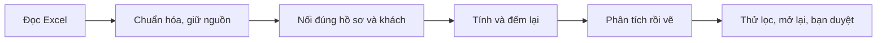

# Hiểu cách làm DA qua InsuranceOps

DA là **phân tích dữ liệu (Data Analytics)**: dùng những gì đã ghi nhận để hỗ trợ quyết định. Hãy hình dung một tủ hồ sơ. Muốn biết nhóm nào xử lý lâu, trước hết phải đếm đúng hồ sơ, tìm đúng ngày và đặt đúng hồ sơ vào cùng nhóm. Sau đó mới tính số và đọc biểu đồ. Quy trình của dự án đi theo cách này:

## Thuật ngữ gặp trong dự án

| Từ thường gặp | Hiểu đơn giản bằng ví dụ |
|---|---|
| Mức ghi nhận — grain | Một dòng nói về cái gì? Dòng khiếu nại khác dòng khách; 13.846 hồ sơ không phải 13.846 người |
| Khóa — key/ID | Mã hồ sơ hoặc mã khách, giống số nhãn trên hồ sơ |
| Quan hệ — relationship | Dùng mã khách để tìm đúng thông tin người có hồ sơ đó |
| Fact và dimension | Bảng việc đã xảy ra và bảng nhãn để phân nhóm; ví dụ khiếu nại và loại khiếu nại |
| Làm sạch — cleaning | Sửa cách đọc số/ngày, chỉ xử lý lỗi theo quy tắc đã chốt; không tự điền phần thiếu |
| Dấu vết nguồn — lineage | Biết số trên màn hình đến từ bảng nào và được tính ra sao |
| Công thức — measure/DAX | Cách đếm hoặc tính mà Power BI thực hiện lại khi bạn chọn nhóm |
| Phạm vi lọc — filter context | Bạn chỉ lấy những hồ sơ hợp điều kiện đang chọn ra xem |
| Nhóm đang xét — cohort | Ví dụ 62 hồ sơ Urgent cùng Email, không phải toàn bộ dữ liệu |
| Mẫu số — denominator | Tỷ lệ hài lòng chia cho 7.687 hồ sơ đã đánh giá, không phải 13.846 hồ sơ |
| Mức có dữ liệu — coverage | Chỉ 55,52% hồ sơ có đánh giá; tỷ lệ hài lòng chưa kể được ý kiến phần còn lại |
| Trung bình và trung vị — mean/median | Các số 1, 2, 3, 4, 20 có trung bình 6 nhưng trung vị 3; một ca rất lâu kéo trung bình lên |
| Từ đầu năm — YTD | Tháng 3 có 552 hồ sơ trong một nhóm; cộng từ tháng 1 đến tháng 3 thành 708 |
| Tại một mốc — as-of | Hỏi tình trạng vào ngày nào thì chỉ dùng thông tin đã xảy ra đến ngày đó |
| Thời gian ở trạng thái — dwell time | Khác tuổi hồ sơ: hồ sơ mở 10 ngày chưa chắc đã ở trạng thái chờ đủ 10 ngày |
| Trên 1.000 khách | Một khách có thể gửi nhiều hồ sơ; 1.137,78 hồ sơ/1.000 khách không phải tỷ lệ 113,78% khách khiếu nại |
| Nhóm quá nhỏ — small sample | Một người không hài lòng cho tỷ lệ 100%; chưa đủ để nói cả nhóm có vấn đề |
| Chênh lệch và nguyên nhân | Urgent lâu hơn trong mẫu chưa chứng minh việc đánh dấu Urgent làm hồ sơ chậm |

## Các nguyên tắc DA được dùng để làm gì?

| Nguyên tắc | Cách hiểu | Áp dụng hoặc giới hạn trong dự án |
|---|---|---|
| SMART | Mục tiêu rõ, đo được, có thời hạn | Chốt sản phẩm và phép kiểm; mục tiêu cải thiện vận hành còn cần chủ việc duyệt |
| 5W1H | Việc gì, ai, khi nào, ở đâu, vì sao, làm thế nào | Làm rõ câu hỏi khiếu nại; “vì sao” chưa rõ thì giữ là giả thuyết |
| MECE | Chia nhóm không đếm trùng, không bỏ sót | 6.867 hài lòng + 820 không hài lòng + 6.159 chưa đánh giá = 13.846 |
| GIGO | Đầu vào sai dễ cho kết quả sai | Ghi rõ 491 tuổi âm và 193 thiếu tuổi; không tự đoán ngày sinh |
| Pareto | Xem phần nào đóng góp nhiều để ưu tiên | Dùng lượng và tỷ lệ để chọn nhóm đáng rà; không ép dữ liệu phải theo quy luật 80/20 |
| KISS | Làm vừa đủ để người xem quyết định | Hai trang với câu hỏi rõ; không thêm mô hình học máy chỉ cho đủ công nghệ |
| STAR | Kể bối cảnh → việc cần làm → đã làm → kết quả | Báo cáo kết quả thực tế; không kể đề xuất chưa làm như thành tích |

Đây là nguyên tắc suy nghĩ, không phải bảy thuật toán bắt buộc. STAR để kể chuyện dự án khác với **star schema**, tức cách nối bảng dữ liệu quanh một bảng việc chính. Một biểu đồ đẹp chỉ giúp đọc dễ hơn; nó không thay việc đếm lại từ nguồn. Mỗi kết luận vẫn phải có số hồ sơ, cách tính và điều chưa biết.

## Cách học qua chính dashboard

1. Mở trang Tổng quan, bỏ chọn để thấy 13.846 hồ sơ.
2. Đọc tỷ lệ hài lòng cùng mức có đánh giá: 89,33% và 55,52% trả lời hai câu khác nhau.
3. Chọn năm 2019 và APPLICATION REQUEST: tổng còn 32; hiểu rằng bạn đang xem một nhóm nhỏ.
4. Sang trang Vận hành, bỏ các chọn trước rồi chọn Urgent và Email: tổng là 62; so trung bình với trung vị.
5. Bỏ chọn, rồi chỉ viết một nhận xét gồm: **nhóm nào → bao nhiêu hồ sơ → số nói gì → nên xem gì tiếp → còn thiếu gì**.

Khi thấy một từ khó, dùng ba câu: “Nó trả lời câu hỏi gì?”, “Ví dụ trong dashboard là gì?”, “Dễ hiểu sai chỗ nào?”. Đây cũng là cách supervisor phải giải thích sau mỗi phase và trong toàn bộ nội dung bàn giao. Bạn không cần đọc DAX hay log để hiểu kết quả chính. Khi muốn xem cách tính, mở phần kỹ thuật [hiểu nguồn](01_data_understanding.md), [chuyển đổi](02_transformation.md), [model](03_semantic_model.md), [công thức](04_measures.md).
